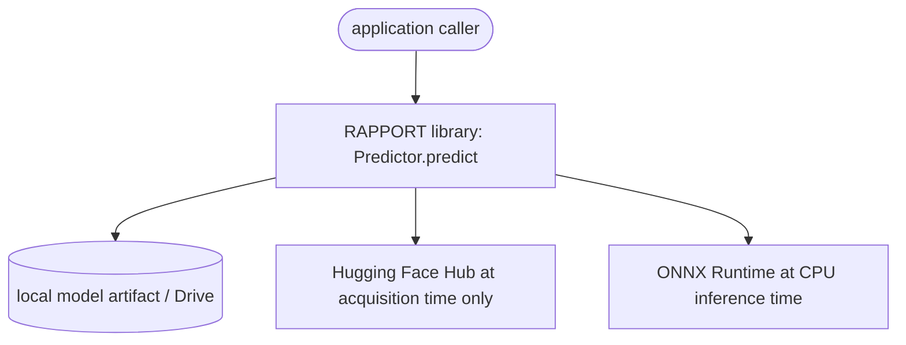
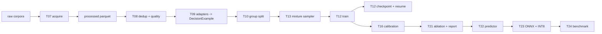
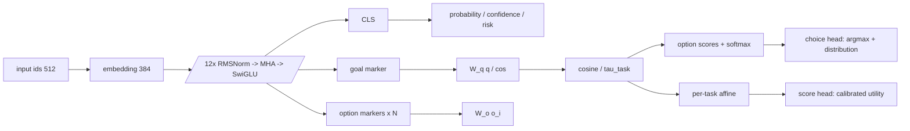
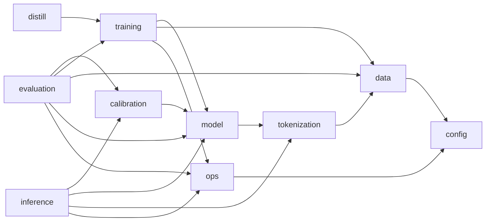

# RAPPORT — Mermaid snippets

Diagrams for the artifacts under `.archgen/rapport/`. Node counts stay at or below 15.

## System context

## Pipeline (container view)

## Model dataflow

## Integration module DAG

Condensed view — edges run consumer → provider (`A --> B` means "A depends on B"). The graph is acyclic. Edges to `config` are shown for modules that reach it directly.

